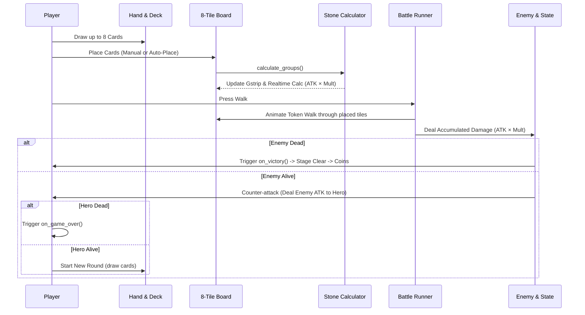

# ToBeyond Game Development Skill & System Path Guide

This skill provides developers and AI assistants with the architectural blueprint, complete node path reference, and game mechanics for **ToBeyond** on Godot 4 (GDScript).

---

## 1. System Architecture & Node Path Graph

```mermaid
graph TD
    Main["Main (Control)\nres://scenes/main.tscn"]
    
    %% Top Bar
    Main --> TopBar["TopBar (HBoxContainer)"]
    TopBar --> StageLabel["StageLabel (Label)\n$TopBar/StageLabel"]
    TopBar --> CoinsLabel["CoinsLabel (Label)\n$TopBar/CoinsLabel"]
    TopBar --> RestartBtn["RestartBtn (Button)\n$TopBar/RestartBtn"]
    
    %% Preview Area
    Main --> Preview["Preview (HBoxContainer)"]
    Preview --> HeroCol["HeroCol (VBoxContainer)"]
    HeroCol --> HeroPic["HeroPic (Label)\n$Preview/HeroCol/HeroPic"]
    HeroCol --> HeroHPText["HeroHPText (Label)\n$Preview/HeroCol/HeroHPText"]
    HeroCol --> HeroHPBar["HeroHPBar (ProgressBar)\n$Preview/HeroCol/HeroHPBar"]
    
    Preview --> CenterCol["CenterCol (VBoxContainer)"]
    CenterCol --> Title["Title (Label)\n$Preview/CenterCol/Title"]
    CenterCol --> CalcLabel["CalcLabel (Label)\n$Preview/CenterCol/CalcLabel"]
    
    Preview --> EnemyCol["EnemyCol (VBoxContainer)"]
    EnemyCol --> EnemyPic["EnemyPic (Label)\n$Preview/EnemyCol/EnemyPic"]
    EnemyCol --> EnemyName["EnemyName (Label)\n$Preview/EnemyCol/EnemyName"]
    EnemyCol --> EnemyHPText["EnemyHPText (Label)\n$Preview/EnemyCol/EnemyHPText"]
    EnemyCol --> EnemyHPBar["EnemyHPBar (ProgressBar)\n$Preview/EnemyCol/EnemyHPBar"]
    EnemyCol --> EnemyAtkText["EnemyAtkText (Label)\n$Preview/EnemyCol/EnemyAtkText"]
    EnemyCol --> MsgLabel["MsgLabel (Label)\n$Preview/EnemyCol/MsgLabel"]
    
    %% Board Section
    Main --> BoardSection["BoardSection (Control)"]
    BoardSection --> BoardBg["BoardBg (Panel)\n$BoardSection/BoardBg"]
    BoardSection --> TilesContainer["TilesContainer (HBoxContainer)\n$BoardSection/TilesContainer\n(Tiles 1..8)"]
    BoardSection --> GstripContainer["GstripContainer (HBoxContainer)\n$BoardSection/GstripContainer\n(Badges 1..8)"]
    BoardSection --> Token["Token (Control)\n$BoardSection/Token"]
    
    %% Bottom Section
    Main --> BottomSection["BottomSection (VBoxContainer)"]
    BottomSection --> HandContainer["HandContainer (HBoxContainer)\n$BottomSection/HandContainer\n(Cards in Hand)"]
    BottomSection --> ControlsRow["ControlsRow (HBoxContainer)"]
    
    ControlsRow --> ToolCol["ToolCol (VBoxContainer)"]
    ToolCol --> DeckCountLabel["DeckCountLabel (Label)\n$BottomSection/ControlsRow/ToolCol/DeckCountLabel"]
    ToolCol --> StoneBtn["StoneBtn (Button)\n$BottomSection/ControlsRow/ToolCol/StoneBtn"]
    
    ControlsRow --> ActionCol["ActionCol (HBoxContainer)"]
    ActionCol --> WalkBtn["WalkBtn (Button)\n$BottomSection/ControlsRow/ActionCol/WalkBtn"]
    ActionCol --> SortGroup["SortGroup (HBoxContainer)"]
    SortGroup --> SortColorBtn["SortColorBtn (Button)\n$BottomSection/ControlsRow/ActionCol/SortGroup/SortColorBtn"]
    SortGroup --> SortDirBtn["SortDirBtn (Button)\n$BottomSection/ControlsRow/ActionCol/SortGroup/SortDirBtn"]
    ActionCol --> DiscardBtn["DiscardBtn (Button)\n$BottomSection/ControlsRow/ActionCol/DiscardBtn"]
    
    %% Modals
    Main --> RewardModal["RewardModal (PanelContainer)\n$RewardModal"]
    RewardModal --> RewardInfo["$RewardModal/VBox/RewardInfo"]
    RewardModal --> NextBtn["$RewardModal/VBox/NextBtn"]
    
    Main --> GameOverModal["GameOverModal (PanelContainer)\n$GameOverModal"]
    GameOverModal --> GameOverInfo["$GameOverModal/VBox/GameOverInfo"]
    GameOverModal --> RetryBtn["$GameOverModal/VBox/RetryBtn"]
    
    Main --> StoneModal["StoneModal (PanelContainer)\n$StoneModal"]
    StoneModal --> StoneList["$StoneModal/VBox/Scroll/List"]
    StoneModal --> CloseBtn["$StoneModal/VBox/CloseBtn"]
```



---

## 2. Node Path Reference Table

| Target Node | Exact Relative Path | Type | Usage |
| :--- | :--- | :--- | :--- |
| **Stage Label** | `$TopBar/StageLabel` | `Label` | Shows current level/stage |
| **Coins Label** | `$TopBar/CoinsLabel` | `Label` | Shows coins balance |
| **Restart Button** | `$TopBar/RestartBtn` | `Button` | Resets game to stage 1 |
| **Hero HP Bar** | `$Preview/HeroCol/HeroHPBar` | `ProgressBar` | Green health bar |
| **Hero HP Text** | `$Preview/HeroCol/HeroHPText` | `Label` | `HP: %d / %d` |
| **Hero Avatar** | `$Preview/HeroCol/HeroPic` | `Label` | `🧙` with cast/hurt animations |
| **Damage Formula** | `$Preview/CenterCol/CalcLabel` | `Label` | `ATK × MULT = TOTAL` |
| **Enemy HP Bar** | `$Preview/EnemyCol/EnemyHPBar` | `ProgressBar` | Red health bar |
| **Enemy HP Text** | `$Preview/EnemyCol/EnemyHPText` | `Label` | Enemy HP display |
| **Enemy Avatar** | `$Preview/EnemyCol/EnemyPic` | `Label` | `👹` with shake/hurt animations |
| **Enemy Atk** | `$Preview/EnemyCol/EnemyAtkText` | `Label` | Enemy damage indicator |
| **Message Label** | `$Preview/EnemyCol/MsgLabel` | `Label` | Turn status message |
| **Board Tiles** | `$BoardSection/TilesContainer` | `HBoxContainer` | Holds the 8 Board Tile buttons |
| **Gstrip Badges** | `$BoardSection/GstripContainer` | `HBoxContainer` | Holds the 8 Combo ATK score labels |
| **Flame Token** | `$BoardSection/Token` | `Control` | Moving token traversing active tiles |
| **Hand Container** | `$BottomSection/HandContainer` | `HBoxContainer` | Dynamic hand cards |
| **Deck Count** | `$BottomSection/ControlsRow/ToolCol/DeckCountLabel` | `Label` | Remaining deck cards count |
| **Stone Formulas** | `$BottomSection/ControlsRow/ToolCol/StoneBtn` | `Button` | Opens formula guide popup |
| **Walk Button** | `$BottomSection/ControlsRow/ActionCol/WalkBtn` | `Button` | Walk / Auto-Place cards |
| **Sort Color** | `$BottomSection/ControlsRow/ActionCol/SortGroup/SortColorBtn` | `Button` | Sorts hand by Gem color |
| **Sort Direction** | `$BottomSection/ControlsRow/ActionCol/SortGroup/SortDirBtn` | `Button` | Sorts hand by direction |
| **Discard Button** | `$BottomSection/ControlsRow/ActionCol/DiscardBtn` | `Button` | Discards selected cards (max 3/round) |
| **Reward Modal** | `$RewardModal` | `PanelContainer` | Victory popup |
| **Game Over Modal**| `$GameOverModal` | `PanelContainer` | Defeat popup |
| **Stone Modal** | `$StoneModal` | `PanelContainer` | Stone recipes reference |

---

## 3. Data Flow & Game Lifecycle



---

## 4. Asset Loading Rule (Critical)

> ⚠️ **NEVER use `preload()` for newly added raw assets (SVG/PNG) without checking.**  
> If an asset has not yet been processed by Godot's importer, `preload("res://assets/...")` hard-crashes the entire script at parse time with:  
> `Parse Error: Preload file "..." has no resource loaders (unrecognized file extension).`

### Correct Pattern:
Use safe dynamic loading in `_ready()` with fallback:

```gdscript
var textures = {}

func init_textures() -> void:
    for d in ["N", "E", "S", "W"]:
        var path = "res://assets/emblems/emblem_%s.svg" % d.to_lower()
        if ResourceLoader.exists(path):
            textures[d] = load(path)
```

---

## 5. Stone Formulas Specification

| Key | Name | Condition | Min Cards | Base ATK (a) | Gain/Card (g) |
| :--- | :--- | :--- | :---: | :---: | :---: |
| `col` | สีเรียงกัน | Contiguous cards with identical color | 1 | 1 | 1 |
| `dsame` | ทิศเรียงกัน | Contiguous cards with identical direction | 2 | 2 | 1 |
| `alt` | สลับสี | Two colors strictly alternating | 3 | 3 | 1 |
| `dtile` | ทิศตรงช่อง | Every card direction matches innate tile direction | 1 | 2 | 2 |
| `cd` | สีทิศ | Same color AND every card matches tile direction | 2 | 3 | 3 |
| `twin` | ฝาแฝด | Identical card (same color AND same direction) | 2 | 4 | 4 |

**Formula:** $\text{ATK} = a + g \times (n - 1)$ where $n$ is number of cards in contiguous group.
