# ToBeyond - System Architecture & Node Path Map

แผนผังโครงสร้างของ Scene Node และระบบทั้งหมดในเกม ToBeyond สำหรับใช้อ้างอิงการพัฒนา

---

## 1. Scene Tree Hierarchy (แผนผัง Node Path)

```mermaid
graph TD
    Main["Main (Control)\nres://scenes/main.tscn"]
    
    %% Top Bar
    Main --> TopBar["TopBar (HBoxContainer)"]
    TopBar --> StageLabel["StageLabel (Label)\n$TopBar/StageLabel"]
    TopBar --> CoinsLabel["CoinsLabel (Label)\n$TopBar/CoinsLabel"]
    TopBar --> SpeedBtn["SpeedBtn (Button)\n$TopBar/SpeedBtn"]
    TopBar --> RestartBtn["RestartBtn (Button)\n$TopBar/RestartBtn"]
    
    %% Preview Area
    Main --> Preview["Preview (HBoxContainer)"]
    Preview --> HeroCol["HeroCol (VBoxContainer)"]
    HeroCol --> HeroPic["HeroPic (Label)\n$Preview/HeroCol/HeroPic"]
    HeroCol --> HeroHPText["HeroHPText (Label)\n$Preview/HeroCol/HeroHPText"]
    HeroCol --> HeroHPBar["HeroHPBar (ProgressBar)\n$Preview/HeroCol/HeroHPBar"]
    
    Preview --> CenterCol["CenterCol (VBoxContainer)"]
    CenterCol --> Title["Title (Label)\n$Preview/CenterCol/Title"]
    CenterCol --> CalcLabel["CalcLabel (Label)\n$Preview/CenterCol/CalcLabel"]
    
    Preview --> EnemyCol["EnemyCol (VBoxContainer)"]
    EnemyCol --> EnemyPic["EnemyPic (Label)\n$Preview/EnemyCol/EnemyPic"]
    EnemyCol --> EnemyName["EnemyName (Label)\n$Preview/EnemyCol/EnemyName"]
    EnemyCol --> EnemyHPText["EnemyHPText (Label)\n$Preview/EnemyCol/EnemyHPText"]
    EnemyCol --> EnemyHPBar["EnemyHPBar (ProgressBar)\n$Preview/EnemyCol/EnemyHPBar"]
    EnemyCol --> EnemyAtkText["EnemyAtkText (Label)\n$Preview/EnemyCol/EnemyAtkText"]
    EnemyCol --> MsgLabel["MsgLabel (Label)\n$Preview/EnemyCol/MsgLabel"]
    
    %% Artifact Row
    Main --> ArtifactRow["ArtifactRow (HBoxContainer)\n$ArtifactRow\n(Slots 1..5)"]

    %% Board Section
    Main --> BoardSection["BoardSection (Control)"]
    BoardSection --> BoardBg["BoardBg (Panel)\n$BoardSection/BoardBg"]
    BoardSection --> TilesContainer["TilesContainer (HBoxContainer)\n$BoardSection/TilesContainer\n(Tiles 1..8)"]
    BoardSection --> GstripContainer["GstripContainer (HBoxContainer)\n$BoardSection/GstripContainer\n(Badges 1..8)"]
    BoardSection --> Token["Token (Control)\n$BoardSection/Token"]
    
    %% Bottom Section
    Main --> BottomSection["BottomSection (VBoxContainer)"]
    BottomSection --> HandContainer["HandContainer (HBoxContainer)\n$BottomSection/HandContainer\n(Cards in Hand)"]
    BottomSection --> ControlsRow["ControlsRow (HBoxContainer)"]
    
    ControlsRow --> ToolCol["ToolCol (VBoxContainer)"]
    ToolCol --> DeckCountBtn["DeckCountBtn (Button)\n$BottomSection/ControlsRow/ToolCol/DeckCountBtn"]
    ToolCol --> StoneBtn["StoneBtn (Button)\n$BottomSection/ControlsRow/ToolCol/StoneBtn"]
    
    ControlsRow --> ActionCol["ActionCol (HBoxContainer)"]
    ActionCol --> WalkBtn["WalkBtn (Button)\n$BottomSection/ControlsRow/ActionCol/WalkBtn"]
    ActionCol --> SortGroup["SortGroup (HBoxContainer)"]
    SortGroup --> SortColorBtn["SortColorBtn (Button)\n$BottomSection/ControlsRow/ActionCol/SortGroup/SortColorBtn"]
    SortGroup --> SortDirBtn["SortDirBtn (Button)\n$BottomSection/ControlsRow/ActionCol/SortGroup/SortDirBtn"]
    ActionCol --> DiscardBtn["DiscardBtn (Button)\n$BottomSection/ControlsRow/ActionCol/DiscardBtn"]
    
    %% Modals
    Main --> RewardModal["RewardModal (PanelContainer)\n$RewardModal"]
    Main --> GameOverModal["GameOverModal (PanelContainer)\n$GameOverModal"]
    Main --> StoneModal["StoneModal (PanelContainer)\n$StoneModal"]
    Main --> DeckModal["DeckModal (PanelContainer)\n$DeckModal"]
    Main --> ShopModal["ShopModal (PanelContainer)\n$ShopModal"]

    %% Effects Layer
    Main --> EffectsLayer["EffectsLayer (Control)\n$EffectsLayer"]
    EffectsLayer --> BeamLine["BeamLine (Line2D)\n$EffectsLayer/BeamLine"]
    EffectsLayer --> EnemyBeamLine["EnemyBeamLine (Line2D)\n$EffectsLayer/EnemyBeamLine"]
    EffectsLayer --> Toast["Toast (PanelContainer)\n$EffectsLayer/Toast"]
    Toast --> ToastLabel["ToastLabel (Label)\n$EffectsLayer/Toast/ToastLabel"]
```



---

## 2. ตารางรวม Node Path อ้างอิงทั้งหมดในสคริปต์

| ตัวแปรในโค้ด | Path ที่ต้องใช้ใน `$Node` | ประเภท Node | หน้าที่ |
| :--- | :--- | :--- | :--- |
| `stage_label` | `$TopBar/StageLabel` | `Label` | แสดงเลขด่านปัจจุบัน |
| `coins_label` | `$TopBar/CoinsLabel` | `Label` | แสดงเหรียญสะสม |
| `speed_btn` | `$TopBar/SpeedBtn` | `Button` | ปุ่มเร่งความเร็วแอนิเมชัน (x1 / x2 / x3) |
| `restart_btn` | `$TopBar/RestartBtn` | `Button` | ปุ่มเริ่มเกมใหม่ |
| `hero_hp_bar` | `$Preview/HeroCol/HeroHPBar` | `ProgressBar` | หลอดเลือดฮีโร่ |
| `hero_hp_label` | `$Preview/HeroCol/HeroHPText` | `Label` | ข้อความเลือดฮีโร่ |
| `hero_pic` | `$Preview/HeroCol/HeroPic` | `Label` | รูปอวาตาร์ฮีโร่ (`🧙`) |
| `calc_label` | `$Preview/CenterCol/CalcLabel` | `Label` | แสดงสูตรดาเมจ `ATK × MULT = TOTAL` |
| `enemy_name` | `$Preview/EnemyCol/EnemyName` | `Label` | ชื่อศัตรู |
| `enemy_pic` | `$Preview/EnemyCol/EnemyPic` | `Label` | รูปศัตรู (`👹`) |
| `enemy_hp_bar` | `$Preview/EnemyCol/EnemyHPBar` | `ProgressBar` | หลอดเลือดศัตรู |
| `enemy_hp_label` | `$Preview/EnemyCol/EnemyHPText` | `Label` | ข้อความเลือดศัตรู |
| `enemy_atk_label` | `$Preview/EnemyCol/EnemyAtkText` | `Label` | พลังโจมตีของศัตรู |
| `msg_label` | `$Preview/EnemyCol/MsgLabel` | `Label` | ข้อความแจ้งเตือนสถานะรอบ |
| `tiles_container` | `$BoardSection/TilesContainer` | `HBoxContainer` | บรรจุช่องกระดาน 8 ช่อง (`Tile1` .. `Tile8`) |
| `gstrip_container` | `$BoardSection/GstripContainer` | `HBoxContainer` | บรรจุป้ายแต้มคอมโบ 8 ช่อง (`G1` .. `G8`) |
| `token` | `$BoardSection/Token` | `Control` | ลูกไฟเคลื่อนที่บนกระดาน |
| `hand_container` | `$BottomSection/HandContainer` | `HBoxContainer` | บรรจุการ์ดบนมือของผู้เล่น |
| `deck_count_btn`| `$BottomSection/ControlsRow/ToolCol/DeckCountBtn` | `Button` | แสดงจำนวนการ์ดคงเหลือในกอง และกดเพื่อเปิดดูการ์ด |
| `stone_btn` | `$BottomSection/ControlsRow/ToolCol/StoneBtn` | `Button` | ปุ่มเปิดหน้าต่างดูสูตร Stone |
| `walk_btn` | `$BottomSection/ControlsRow/ActionCol/WalkBtn` | `Button` | ปุ่มเดิน / วางการ์ดอัตโนมัติ |
| `sort_color_btn` | `$BottomSection/ControlsRow/ActionCol/SortGroup/SortColorBtn` | `Button` | ปุ่มสลับโหมดจัดเรียงตามสี |
| `sort_dir_btn` | `$BottomSection/ControlsRow/ActionCol/SortGroup/SortDirBtn` | `Button` | ปุ่มสลับโหมดจัดเรียงตามทิศ |
| `discard_btn` | `$BottomSection/ControlsRow/ActionCol/DiscardBtn` | `Button` | ปุ่มทิ้งการ์ดที่เลือก (สูงสุด 3 ครั้ง) |
| `reward_modal` | `$RewardModal` | `PanelContainer` | ป๊อปอัปเมื่อชนะด่าน |
| `gameover_modal` | `$GameOverModal` | `PanelContainer` | ป๊อปอัปเมื่อพ่ายแพ้ |
| `stone_modal` | `$StoneModal` | `PanelContainer` | ป๊อปอัปสูตรการผสมการ์ด Stone |
| `deck_modal` | `$DeckModal` | `PanelContainer` | ป๊อปอัปส่องแจกแจงการ์ดที่เหลือในกอง |
| `shop_modal` | `$ShopModal` | `PanelContainer` | หน้าต่างร้านค้าหลังจบด่าน ซื้อ Artifact และอัปเกรด Stone |
| `artifact_row` | `$ArtifactRow` | `HBoxContainer` | แถบแสดง Artifact 5 ช่อง |
| `effects_layer` | `$EffectsLayer` | `Control` | เลเยอร์เอฟเฟกต์แสดงผลด้านบนสุด |
| `beam_line` | `$EffectsLayer/BeamLine` | `Line2D` | ลำแสงเลเซอร์ฮีโร่ยิงใส่ศัตรู |
| `enemy_beam_line`| `$EffectsLayer/EnemyBeamLine`| `Line2D` | ลำแสงเลเซอร์ศัตรูยิงสวนกลับ |
| `toast` | `$EffectsLayer/Toast` | `PanelContainer` | กล่องแจ้งเตือน Toast ค้นพบสูตรใหม่ |
| `toast_label` | `$EffectsLayer/Toast/ToastLabel` | `Label` | ข้อความในกล่องแจ้งเตือน Toast |

---

## 3. กฎสำคัญเรื่องการโหลดไฟล์ Asset ป้องกัน Error

> ⚠️ **ห้ามใช้ `preload()` โหลดไฟล์กราฟิกที่เพิ่งเพิ่มเข้ามาโดยตรง**  
> หากใช้ `preload("res://assets/...")` แล้วไฟล์นั้นยังไม่ถูก Godot ทำการ Import จะทำให้เกิด Parse Error ทันที:  
> `Parse Error: Preload file "..." has no resource loaders (unrecognized file extension).`

### วิธีเขียนที่ถูกต้องและปลอดภัย 100%:
ให้ใช้การโหลดแบบ Dynamic ในฟังก์ชัน `_ready()` พร้อมระบบ Fallback สำรองเสมอ:

```gdscript
var textures = {}

func init_textures() -> void:
    for d in ["N", "E", "S", "W"]:
        var p = "res://assets/emblems/emblem_%s.svg" % d.to_lower()
        if ResourceLoader.exists(p):
            textures[d] = load(p)
```

